<p align="center">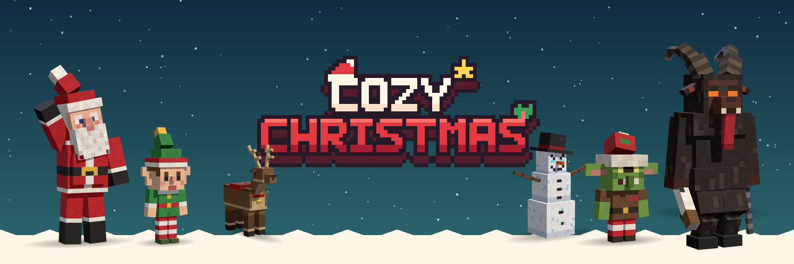</p>

<p align="center">
  
  
  
  
  
  
</p>

<p align="center">
  <a href="#presents">Presents</a> ·
  <a href="#workshop">Santa's workshop</a> ·
  <a href="#krampus">Krampus</a> ·
  <a href="#goblins">Goblins</a> ·
  <a href="#home">Fireplace</a> ·
  <a href="#tree">Tree</a> ·
  <a href="#knitwear">Knitwear</a> ·
  <a href="#citrus">Citrus woods</a> ·
  <a href="#config">Config</a> ·
  <a href="#install">Install</a>
</p>

---

Somewhere in the snow there is a workshop where elves hammer at workbenches, and somewhere higher up a pit with chains hanging in it. Santa keeps a list. So does Krampus, and he is less patient.

Cozy Christmas turns the winter biomes into a Christmas story. Every player has a hidden karma, and what's inside a present depends on it: a real gift, a lump of coal, or a confetti bang. Be kind to villagers and reindeer and the sleigh will have something for you. Be rotten for long enough in the Christmas season and Krampus comes to find you.


<p align="center">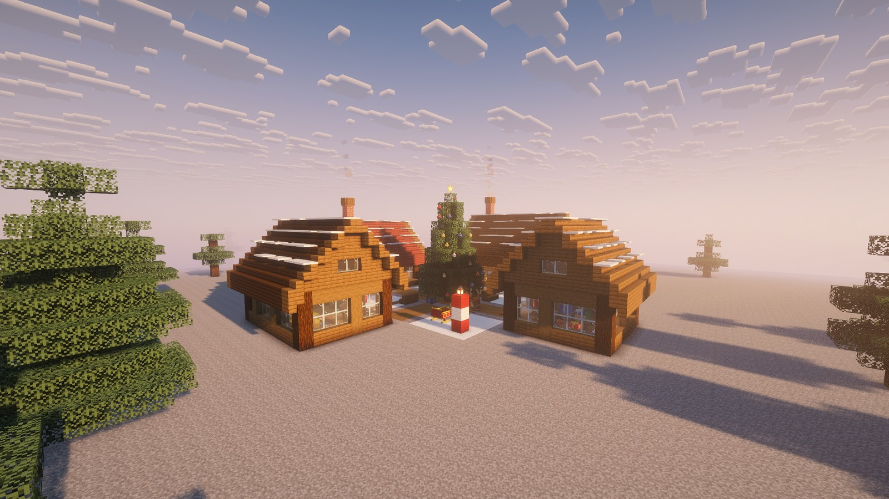</p>

<p align="center">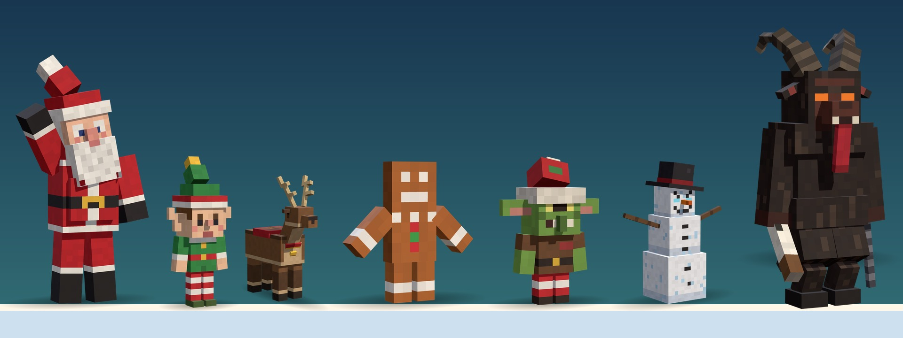</p>


<a id="install"></a>
<p align="center">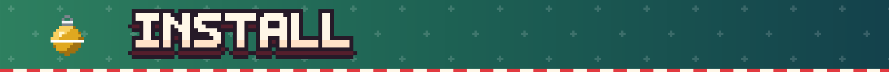</p>

| Minecraft | Loaders | Java | Branch |
| --- | --- | --- | --- |
| 26.3 | Fabric, NeoForge | 25 | `main` |
| 1.21.1 | Fabric, NeoForge | 21 | `1.21.1-dev` |
| 1.20.1 | Fabric, Forge | 17 | `1.20.1-dev` |

Requires [Architectury API](https://modrinth.com/mod/architectury-api) and [GeckoLib](https://modrinth.com/mod/geckolib); on Fabric also [Fabric API](https://modrinth.com/mod/fabric-api). Works in singleplayer and on servers; install it on both sides. Everything else below is optional.

Official downloads: CurseForge and Modrinth only.

---

<a id="presents"></a>
<p align="center">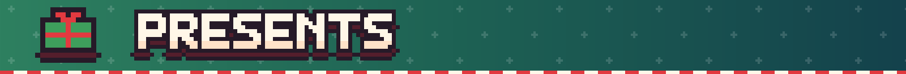</p>
<p align="center">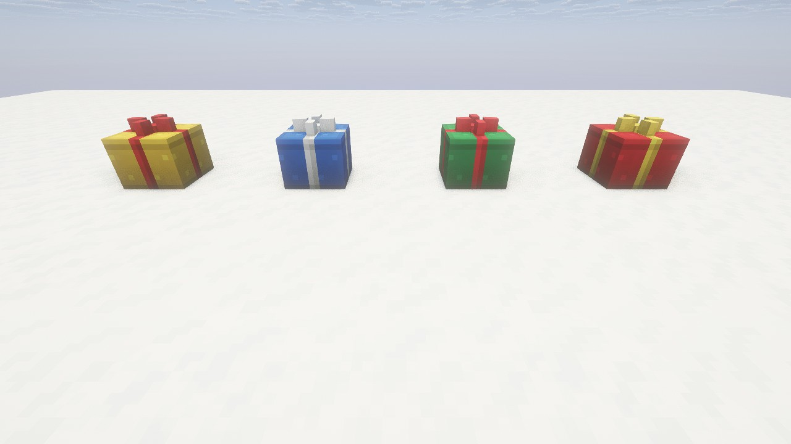</p>
Presents hide something that depends on how you've behaved: a real gift, a lump of coal or a "boom" of confetti and snow (a prank: 4-6 damage and a push, blocks stay intact). A present that's going to go boom ticks and shakes when you stand close, so the careful notice. Break a present to carry it and give it to someone else. During the Christmas season presents now and then turn up in the snow around you.

The **wrapping table** wraps any stack into a present in one of four designs and signs it with your name. Wrap TNT to make your own prank. When someone else opens a gift you wrapped, Santa notices.

What's in a present is the loot tables `cozychristmas:presents/gift` and `cozychristmas:presents/coal`; the tags `#cozychristmas:wraps_as_boom`, `#cozychristmas:wrapping_paper` and `#cozychristmas:unwrappable` tune the table.

<p align="center">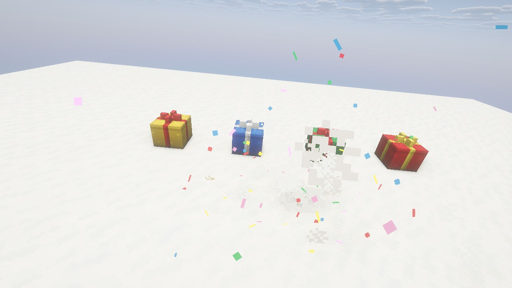</p>


<a id="workshop"></a>
<p align="center">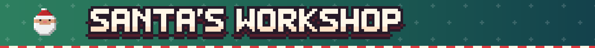</p>
<p align="center">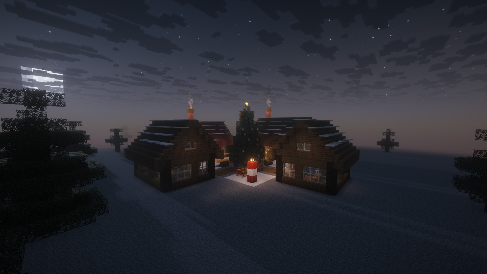 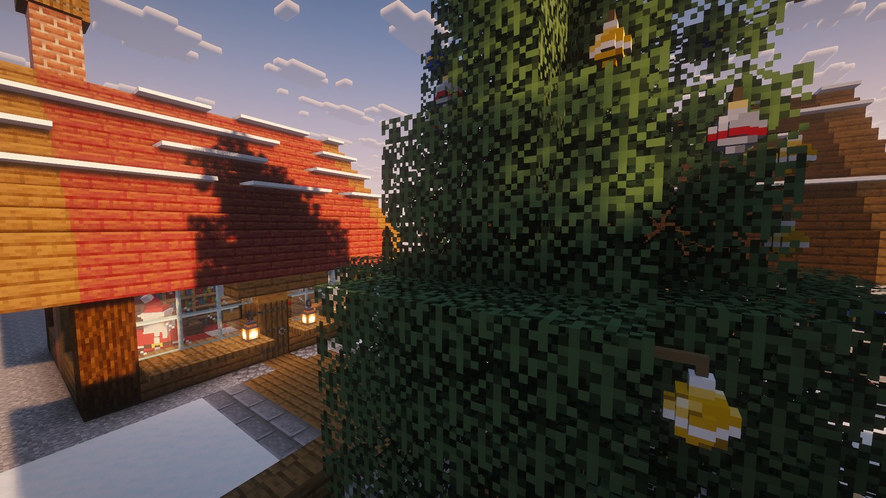</p>
Very rarely, in snowy plains and taiga, you find Santa's workshop: a snowy square with a decorated tree and the sleigh at the way in, the hall where elves hammer at their workbenches, Santa's house, the present warehouse and a stable of reindeer.

- **Santa** trades for emeralds (presents, saddles, knitwear, treats) and buys back your coal. He knows his list: nice players pay less and, during the Christmas season, get a present once a day; naughty ones he turns away. Hurt him or an elf, or take a present from the warehouse, and he comes after you.
- **Elves** work at the workbenches and carry finished presents around. They're harmless: they run from anyone with a weapon out and follow a cookie.
- **Christmas Eve** (24 and 25 December): the reindeer are harnessed to Santa's sleigh and the elves carry their presents to it while Santa stands by. Bring a present yourself to help load it. Each night of those days Santa gets in and the sleigh takes off, bells ringing, and climbs away into the night sky; at dawn it's back with the sack empty, and Santa has a present for everyone who helped.
- **Reindeer** are mounts. Feed a wild one carrots to tame it, golden carrots to breed. Saddled, it flies during the Christmas season: jump to take off, look where you want to go, hold jump to climb. Wild herds live in the taiga too. Feeding reindeer is a good deed.

Where the workshop generates is the biome tag `#cozychristmas:has_structure/santas_workshop`, how often the structure set `cozychristmas:santas_workshop`; Santa's goods are the trade sets `cozychristmas:santa/goods` and `cozychristmas:santa/buying`; elves work at `#cozychristmas:elf_workstations`.

<p align="center">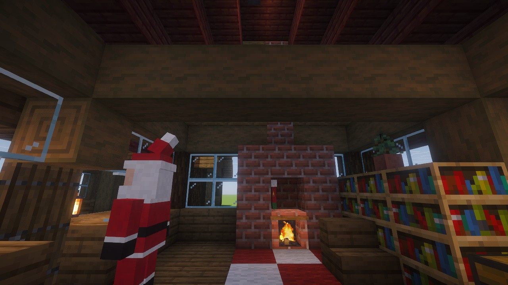 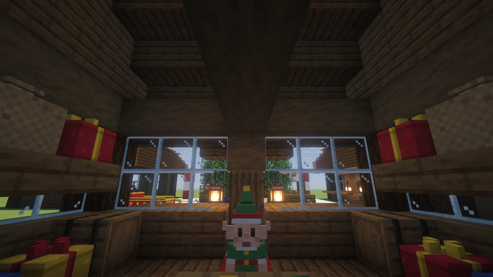</p>
<p align="center">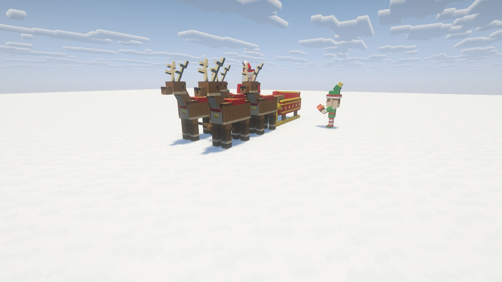</p>


<a id="krampus"></a>
<p align="center">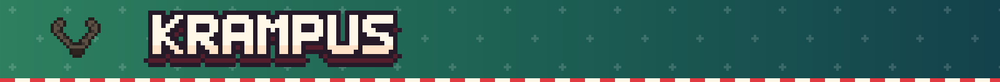</p>
<p align="center">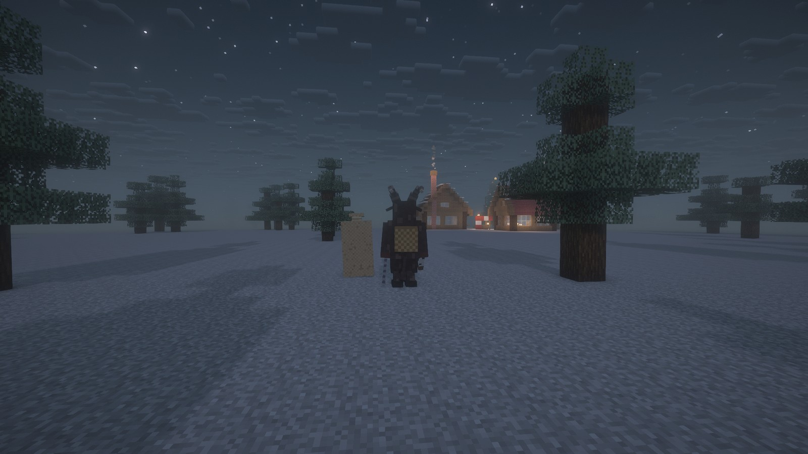</p>
High in snowy mountains a pit in the snow, ringed with ice and hung with chains, leads down to **Krampus's lair**: a cave with his throne, a chest of loot, sacks and coal, and villagers he has locked in cages. He fights with a birch switch, lashes you with his chain and drags you closer, stuffs you into his sack for a moment, and calls present goblins to help. Beat him and your misdeeds are forgiven: your bad karma is gone. He drops his **horns**, a trophy to wear, and his **chain**, a weapon with a long reach.

Be very naughty in the Christmas season and he may come for you himself one night (config `krampus.visits`).

Where lairs generate is the biome tag `#cozychristmas:has_structure/krampus_lair`, how often the structure set `cozychristmas:krampus_lair`.

<p align="center">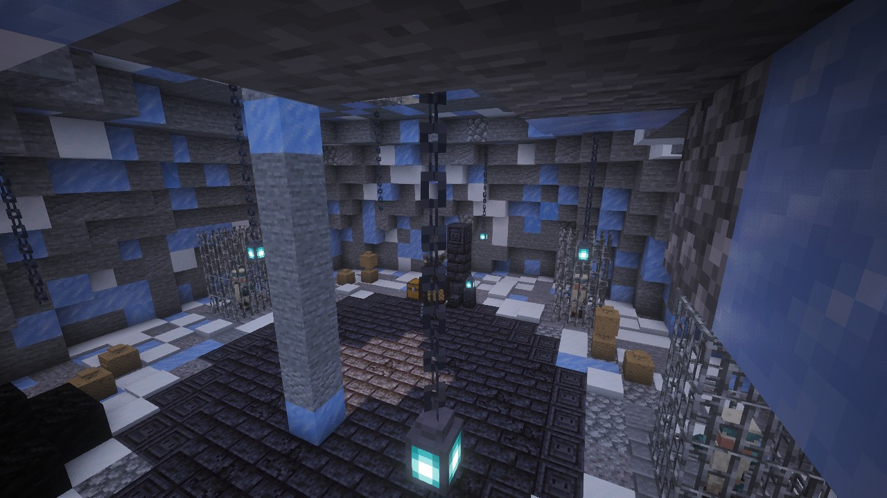</p>


<a id="goblins"></a>
<p align="center">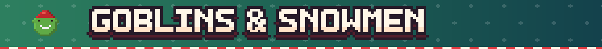</p>
<p align="center">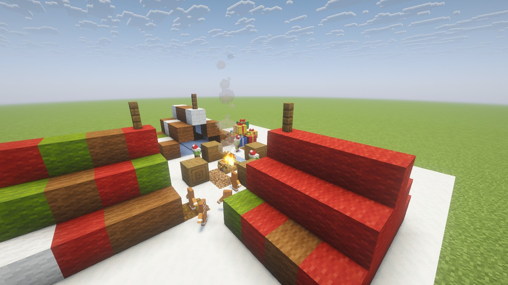</p>
Among ice spikes and on snowy slopes, present goblins camp around a fire: a few patched tents, a heap of stolen presents and a chest of loot, guarded by goblins and packs of gingerbread men.

- **Present goblins** also prowl snowy biomes at night. Instead of hitting you, a goblin snatches a whole stack from your hotbar and runs off with it held over its head. Catch it: you get your things back, a surprise present on top, and getting stolen goods back is a good deed.
- **Gingerbread men** come four to six at a time and are quick but weak. Water makes them soggy. They crumble into gingerbread cookies, which elves love.

Where camps generate is the biome tag `#cozychristmas:has_structure/goblin_camp`, how often the structure set `cozychristmas:goblin_camp`; night goblins spawn in `#cozychristmas:spawns_present_goblins`; items in `#cozychristmas:goblin_proof` are never stolen.

<a id="snowmen"></a>
<p align="center">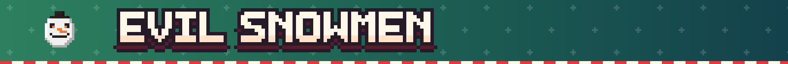</p>
<p align="center">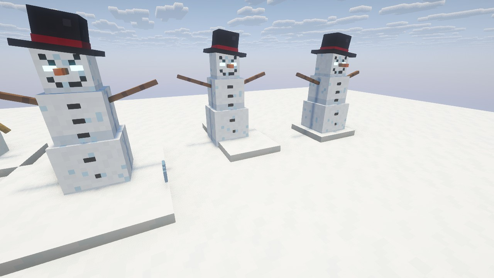</p>
On snowy nights, under the open sky, evil snowmen come out with glowing icy eyes and pelt you with **ice snowballs**: they hurt, slow you down and chill you (warm clothes keep the freezing out). Snowmen melt: fire hurts them three times over, warm biomes melt them, and so does standing near a lit fire, campfire, furnace or fireplace, so a fire at home keeps them away. They drop snowballs and ice snowballs, which you can throw (or load into a dispenser), and sometimes their coal and carrot.

Where they spawn is the biome tag `#cozychristmas:spawns_evil_snowmen`; warm blocks they melt next to are `#cozychristmas:melts_snowmen`.

<a id="home"></a>
<p align="center"></p>
<p align="center">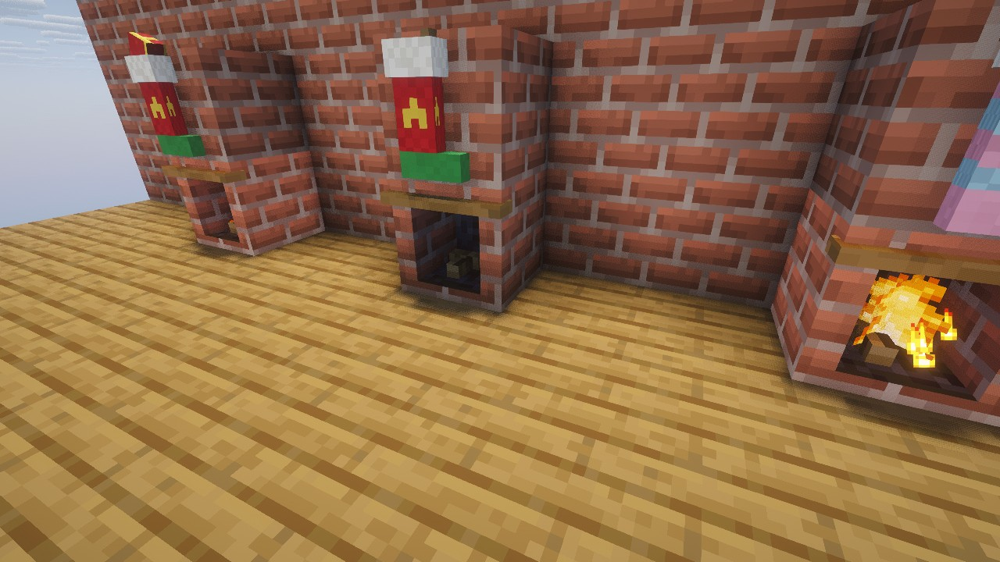</p>
Build a **fireplace** (bricks round a campfire; light it with flint and steel, put it out with a shovel) and hang a **stocking** on the wall above it. On Christmas-season mornings it holds a present, or a lump of coal if you've been naughty: one stocking per player each morning, and only its owner can empty it. Femboy Mod's socks hang as stockings too (sneak and use one on the wall).

Blocks that count as a fireplace are the tag `#cozychristmas:fireplaces`; items that hang as a stocking are `#cozychristmas:hangs_as_stocking`.

<a id="tree"></a>
<p align="center">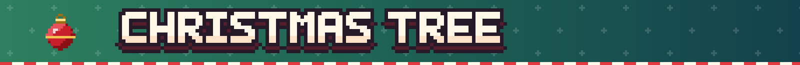</p>
<p align="center">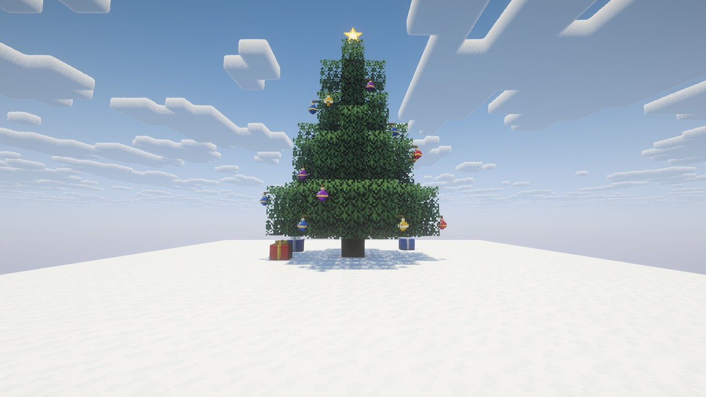 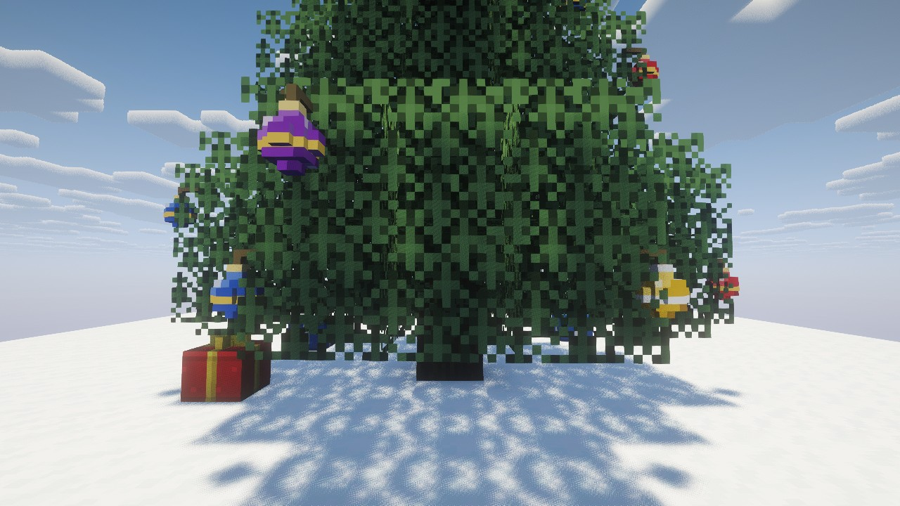</p>
Grow or build a tree (leaves on a trunk), hang **ornaments** on its branches (glass balls in six colors; they hold on to leaves from below or from the side) and put the **tree star** on top. Once it has six ornaments, a present waits under it every Christmas-season morning, for whoever put the star up: what's inside follows their karma. One tree per player a morning, and no more than three unopened presents pile up. Click the star to see how your tree is doing. The tree in the plaza of Santa's workshop is decorated the same way.

What counts as part of a tree is the block tag `#cozychristmas:tree_parts` (leaves and logs), what counts as an ornament `#cozychristmas:tree_ornaments`.

<a id="knitwear"></a>
<p align="center">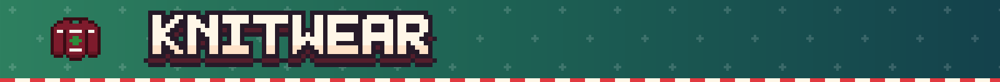</p>
<p align="center">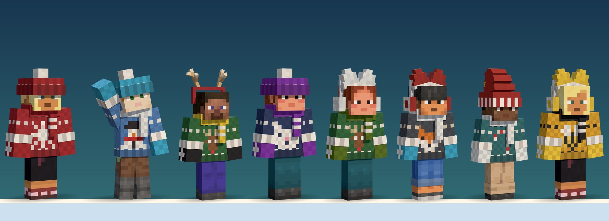</p>
Four cosmetic slots next to your inventory (hat, scarf, sweater, mittens), worn on top of armor: right-click a piece or shift-click it into its slot. Sweaters come in ten patterns: snowflakes, a reindeer, a cat, a bee, a present, a gingerbread man, a Christmas tree, a fox, a snowman or a candy cane (wool round an ingredient that fits the pattern); the pompom hat, scarf and mittens take any dye, like leather armor. Mittens and sleeves show in first person too.

**Head pieces:** fluffy ear warmers (any dye), an elf hat with a bell (any dye) and an antler headband. With [Catgirl & Catboy Mod](https://github.com/eliasnvx/catgirl-catboy-mod) the ear warmers go over your cat ears and move with them; its cosmetics panel and ours sit side by side.

Any item can be made wearable with the `cozychristmas:cosmetic` component (`{"slot": "head"}`); it is then worn, though only the mod's own pieces have a look.

**Toasty set:** a sweater, hat (or ear warmers), scarf and mittens together keep you from freezing in powder snow and make you 10% faster on snow. The tooltip counts the pieces you wear. Pieces are the item tag `#cozychristmas:toasty_set`, the snow is the block tag `#cozychristmas:toasty_snow`.

<a id="food"></a>
<p align="center">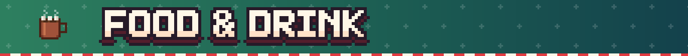</p>
- **Hot cocoa with marshmallows** comes in a brick mug and warms you through: it thaws you and keeps the frost off for two minutes.
- **Mulled wine** heals a little (Regeneration I for 10 seconds).
- **Chestnuts** sometimes fall from dark oak leaves; roast them on a campfire.
- **Tangerines**, **oranges** and **gingerbread cookies** (elves love those).

Santa sells some of it, and presents and chests hold the rest.

<a id="citrus"></a>
<p align="center">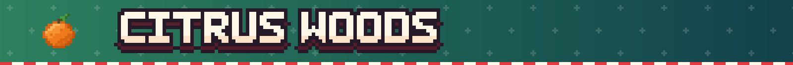</p>
<p align="center">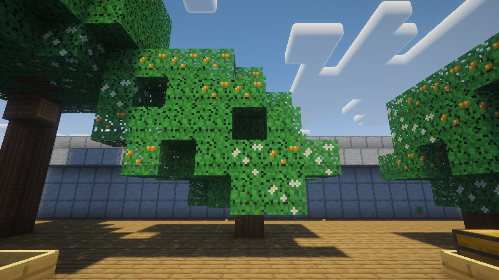 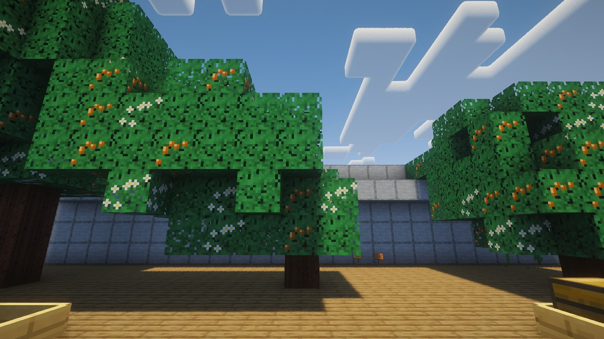</p>
Two new woods with the whole vanilla set: logs and wood (strip them with an axe), planks, stairs, slabs, fence and gate, door, trapdoor, button, pressure plate, signs, hanging signs, boats and chest boats. Their saplings grow into round, bushy trees (now and then a grand one), and the leaves bear fruit: bare, then blossom, then ripe; bone meal moves them a stage on. A right click picks the ripe fruit (tangerines or oranges) and the leaves start over; breaking them drops it too. Tangerine groves grow wild in plains, meadows and forests, orange groves in savannas and sparse jungles (`#cozychristmas:has_tangerine_trees`, `has_orange_trees`); Santa sells saplings and oranges.

<a id="karma"></a>
<p align="center">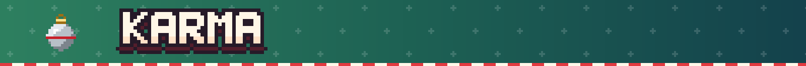</p>
Every player has a hidden karma from -100 to +100. Hurting villagers, elves and other peaceful folk or stealing from Santa lowers it; giving gifts, feeding reindeer and getting back what goblins stole raises it; it drifts back toward zero by about one point per in-game day. Nice players mostly find gifts in their presents, naughty ones find coal.

Mobs that count are in the entity tag `#cozychristmas:karma_protected`, so data packs can change them.

<a id="config"></a>
<p align="center">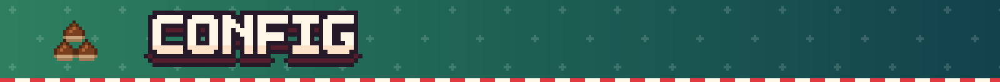</p>
`config/cozychristmas-common.json`: season dates (`real_date`, `always`, `never`, or `serene_seasons` with the sub-seasons that count), karma thresholds and amounts, present odds per karma tier, the warning radius, the boom (damage, radius, knockback, `breaks_blocks`), presents in the snow (`presents.snow`), the Toasty set's bonuses (`keeps_warm`, `snow_speed_bonus`), Santa and the elves (`workshop`: health, anger, the nice discount, daily gifts, the sleigh: whether it flies, how many presents it takes), reindeer (`reindeer`: when they fly, `season` / `always` / `never`, speeds, taming chance, wild herds), goblins (`goblins`: stealing on or off, night spawns, soggy gingerbread), stockings (`stockings`: season only, how much coal), evil snowmen (`evil_snowman`: health, throwing, melting), Krampus (`krampus`: his moves, karma, `visits`), chestnuts from leaves (`food`: which leaves, how often), Christmas trees (`tree`: season only, how many ornaments, how far presents land, how many pile up), tangerine and orange trees (`citrus`: how fast fruit ripens, how much a harvest gives, wild groves on or off). Missing options are filled with defaults; a broken file is kept as `.broken` and replaced.

Operators: `/cozychristmas karma get|set|add <players> [value]`, `/cozychristmas season`.

<a id="compat"></a>
<p align="center">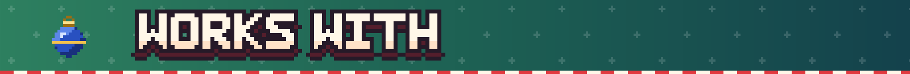</p>
All optional; install any of them alongside.
- **JEI** and **REI**: the wrapping table as a recipe category, information pages for presents, stockings, the tree star and ornaments, the Toasty set, chestnuts, cocoa, ice snowballs and Krampus's trophies.
- **Jade**: whose stocking it is, what it holds and whether it hangs over a fireplace; whose tree a star crowns and how many ornaments it still needs; who wrapped a present (never what's inside).
- **Serene Seasons**: set `season.source` to `serene_seasons` and Christmas follows its calendar (early and mid winter by default; Santa loads the sleigh at the start of mid winter).
- **Curios** (NeoForge): hats, scarves, sweaters and mittens fit its head, necklace, body and hands slots, look the same there and count for the Toasty set.
- **Snowy Spirit**: Santa calls two gingerbread golems to guard his workshop (`workshop.santa.snowy_spirit_guards`), and our reindeer pull its sleds.
- **Catgirl & Catboy Mod**: ear warmers sit over its cat ears. **Femboy Mod**: its socks hang as stockings.

Tradery (Santa trading for its money) comes later.

<a id="build"></a>
<p align="center">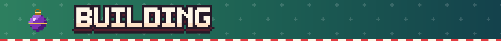</p>
Java 21 on this branch (Minecraft 1.21.1).
```bash
./gradlew build
```

## License
MIT. Part of the [Cubimoon](https://cubimoon.com) mods.
